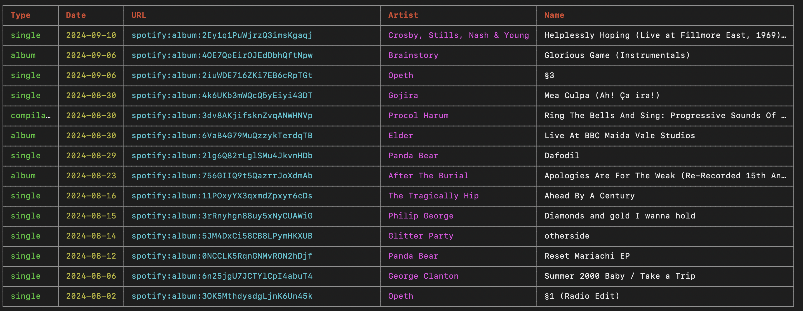

# Better-Release-Radar

This script makes it easy to see all the new album and EP releases by artists you follow on Spotify.

No more fussing around with the `New Releases` playlist or faffing with a flakey notifications feature, now you can look at everything in one neat table!

### Example Output:



### Requirements

This project requires `Node.js` and `npm` to run. It uses TypeScript to manage type safety.

### Authentication

You will need to [set up authentication with Spotify](https://developer.spotify.com/documentation/general/guides/authorization-guide/) such that:

- Your `REDIRECT_URI` for your [Spotify application](https://developer.spotify.com/dashboard/applications) is `http://127.0.0.1:8888/callback`
- Set the following environment variables (e.g., in your `.bashrc`, `.zshrc`, or via an `.env` file):

  ```
  export SPOTIPY_CLIENT_ID='your-spotify-client-id'
  export SPOTIPY_CLIENT_SECRET='your-spotify-client-secret'
  export SPOTIPY_REDIRECT_URI='http://127.0.0.1:8888/callback'
  ```

You can always access or rotate your client ID and secret at the [developer dashboard](https://developer.spotify.com/dashboard/).

### Installation

1. Clone the repository and navigate to the project directory:

   ```
   git clone https://github.com/PaulMcInnis/Better-Release-Radar.git
   cd Better-Release-Radar
   ```

2. Install the required dependencies:

   ```
   npm install
   ```

### Usage

To run the script, simply use the following command:

    npm start

#### CLI Options:

    usage: npm start [-- <options>]

    Options:
      --max-age-days <number>       Maximum number of days to consider for new releases (default: 60)
      --show-urls                   Show full URLs instead of Spotify URIs in the table (default: false)
      --log-file <path>             Path to log file (default: log.log)
      --log-level <level>           Logging level, e.g. debug to see retries (default: info)
      --region <region>             ISO 3166-1 alpha-2 region code to filter albums by availability (default: GB)
      --hide-eps                    Hide EPs, and Singles, and only show full-length releases (default: false)
      --hide-re-releases            Hide re-releases (default: false)
      --hide-live-recordings        Hide live recordings (default: false)
      --hide-soundtracks            Hide soundtracks (default: false)
      --hide-remixes                Hide remixes (default: false)
      --log-filtered                Log filtered albums (default: false)
      --json <path>                 Write all releases to a JSON file
      --html <path>                 Write an interactive HTML page of the releases
      --open                        Open the HTML page in your browser when done
      --no-table                    Don't print the table to the console

### Example Usage:

    npm start -- --max-age-days 90 --hide-eps --show-urls --region US

This will show full album releases from the last 90 days, displaying the full URLs for albums available in the US region.

    npm start -- --max-age-days 360 --hide-re-releases --hide-live-recordings --hide-soundtracks --hide-remixes

This will show full album releases from the last year, filtering out re-releases, live recordings, soundtracks, and remixes using regex matching techniques.

### HTML page and JSON export

    npm start -- --max-age-days 360 --hide-re-releases --hide-live-recordings --json out/releases.json --html out/releases.html --open

Or, as a shortcut for the last 360 days with nothing hidden:

    npm run radar

The HTML page is a single self-contained file showing every release with its cover art. You can:

- search by artist or title, and click an artist's name to show only their releases
- filter by type (Album, EP, Single, Compilation) and by tag (Re-release, Live, Soundtrack, Remix)
- narrow to the past week, month, 3 or 6 months
- sort by newest, oldest, artist, title or track count; date sorts are grouped by month
- switch between a grid of covers and a compact list
- click any release to open it in the Spotify app, or switch to the web player

The JSON file and the HTML page include **all** releases in the date range, each tagged, rather than dropping the ones your `--hide-*` flags filter out. The page starts with those hidden, and you can toggle them back on. To rebuild the page from a JSON file without fetching from Spotify again:

    npm run html -- out/releases.json [out/releases.html] [--open]

Spotify reports EPs as singles, so a single with 4 or more tracks (or "EP" in the title) is shown as an EP.

### Features:

- **Cached Authentication**: The script caches the Spotify access token, so you won't need to re-authenticate each time. If the access token expires, it will automatically refresh using the stored refresh token.
- **Duplicate Removal**: Releases Spotify lists more than once (same artist, type and normalized title) are shown once.
- **Customizable Parameters**: You can filter results by album age, hide EPs, and limit results to a specific region.

### How It Works:

1. **Authentication**: The script handles Spotify's OAuth flow. It will prompt you to authorize the app and then cache the access and refresh tokens for future use.
2. **Fetching Followed Artists**: After authentication, the script retrieves the list of artists you follow.
3. **Fetching Albums**: The script then fetches recent albums from these artists, applying filters for release date, region, and album type.
4. **Displaying Results**: The final results are displayed in a tabular format in your terminal, and optionally written to JSON and an HTML page.

### Troubleshooting:

- **Insufficient Client Scope**: If you see an error about "insufficient client scope," ensure your Spotify application has the correct `user-follow-read` scope configured.
- **Token Expiration**: If the refresh token is rejected (for example after rotating your client secret), the script falls back to the browser login automatically.
- **"redirect_uri: Insecure"**: Spotify no longer accepts `localhost` redirect URIs. Use `http://127.0.0.1:8888/callback` in your Spotify app settings.
- **WSL**: the login callback server listens on IPv4 so the Windows browser can reach `127.0.0.1:8888` inside WSL.

Happy tracking your favorite artists' releases!
